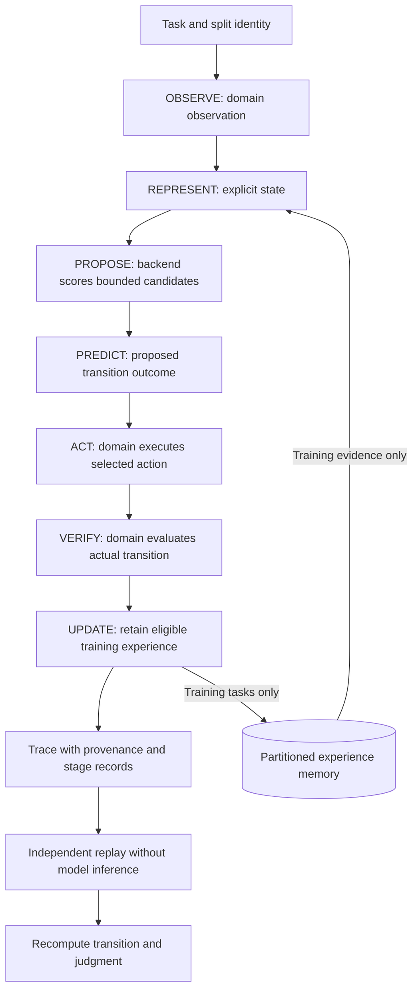
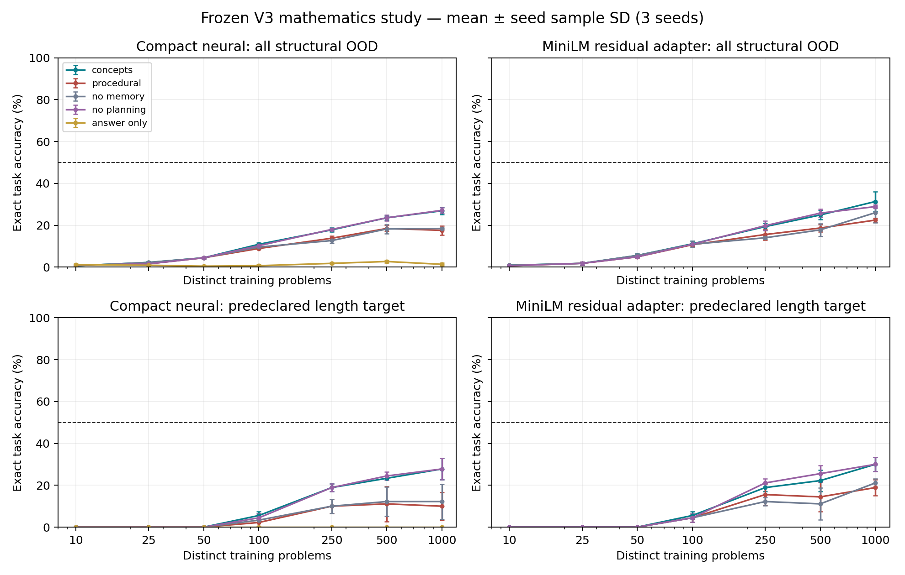
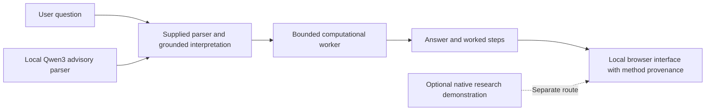

# Mindscape

**Explicit state-transition research, learned numerical claims, and independent trajectory replay.**

Mindscape is a Python research system for studying whether structured state, intermediate supervision, memory, and bounded planning improve task performance under controlled comparisons. It records observations, proposed actions, predicted outcomes, actual transitions, and verification results so that an evaluator can inspect how an answer was produced. Mathematical and coding studies preserve their protocols, controls, measurements, and unsuccessful outcomes; a separately launched hybrid assistant combines a pretrained model with bounded computational tools.

**Research question:** when information and supervision are accounted for, what does an explicit reasoning wrapper contribute beyond the learned model and its supplied procedural scaffold?

[Research tracks](#research-tracks) · [Execution lifecycle](#execution-and-independent-verification) · [Mathematical study](#mathematical-learning-study) · [Reproduce](#reproduce-and-inspect) · [Hybrid assistant](#optional-hybrid-assistant)

## Research tracks

| Track | Implemented system | Evidence |
| --- | --- | --- |
| State-transition foundation | Typed observations, states, actions, events, results and goals; deterministic environments; working, episodic and concept memory; replay verification. | [Foundation decision](docs/decisions/001-foundation.md) · [V3 architecture](docs/v3/architecture.md) |
| Mathematical learning | Compact numerical predictors and a frozen-encoder adapter study; nested data budgets, structural shifts, fixed-weight memory/planning ablations and independent rollout replay. | [Frozen protocol](docs/v3_math/protocol.md) · [Scientific report](docs/v3_math/scientific-report.md) |
| Coding research | Qwen2.5-Coder-1.5B program-repair experiments, recorded tool trajectories, held-out condition/task evaluations, learning cases and replay checks. | [Experimental protocol](docs/coding/final_experimental_protocol.md) · [Recorded metrics](docs/final_metrics.md) |
| Numeric mechanism research | Bounded intervention and computation-trace studies, maintained separately from coding experiments. | [Research v2 reproduction](docs/research_v2/reproduction.md) · [Mechanism study](docs/research_v2/mechanism_study.md) |
| Optional hybrid application | Local Qwen3-0.6B advisory interpretation, supplied parsing, restricted math/physics/code/SQL tools and a browser interface. | [Integration guide](integrations/hybrid/README.md) · [Application architecture](integrations/hybrid/ARCHITECTURE.md) |

Each track has its own task distribution, model, protocol and evidence identity. Results from one track do not establish another track's accuracy. Earlier multiplication and NumPy studies remain available through [historical references](docs/historical_references.md), [training documentation](docs/training.md), and the versioned reports.

## Execution and independent verification

The [V3 kernel](src/mindscape/v3/kernel.py) records a seven-stage cycle. A domain supplies observations, syntactically available candidates, execution and judgment; the backend supplies candidate scores and a transition prediction. The predicted state and actual executed state are distinct records.



The kernel rejects empty, singleton, duplicate, nonfinite or over-budget candidate configurations. It records model/checkpoint identity, source hash, seed, stage events, candidate count, model calls, timing and transition-prediction error where defined. The foundation episodes execute one action without retries. Retrieved training evidence is recorded but marked as unused by the model; the cycle does not update weights. Evaluation experiences do not enter training memory.

The separate [bounded rollout interface](src/mindscape/reasoning/simulator.py) explores hypothetical states under explicit depth and branch limits, scores paths and selects a first action. Hypothetical results remain tagged and do not mutate the real environment. This interface supports deterministic or learned transition adapters; its presence alone does not establish that learned simulation improves task performance.

The mathematical learner is a separate multistep implementation. Its planner scores at most four proposed next-state alternatives using learned consistency and confidence. Proposed numerical values are executed unchanged, including wrong digits or carries. The arithmetic verifier runs after the rollout and supplies no correctness feedback to repair inference.

Replay reconstructs execution rather than asking a model whether its own answer looks plausible:

- The [V3 replay function](src/mindscape/v3/kernel.py) checks stage order, observation binding, candidate set, selected action, executed transition and judgment.
- The [mathematical verifier](src/mindscape/v3/math_learning/verify.py) checks saved-file hashes and replays numerical claims without neural forwards.
- The [foundation verifier](src/mindscape/verification/verifier.py) rebuilds a multiplication environment, checks every actual transition, and requires a completed goal before validating a claimed final answer.

Replay consistency establishes that saved evidence agrees with execution and its declared oracle. It does not establish broad reasoning competence or make a failed task successful.

## Mathematical learning study

The V3 mathematical study asks whether learned local numerical transitions, finite demonstration memory and bounded planning transfer across declared structural shifts. Its source/protocol freeze is **`b43d778`**; the [protocol](docs/v3_math/protocol.md) and [report](docs/v3_math/scientific-report.md) define the interpretation of the following recorded results.

### Data, supervision and controls

| Partition or condition | Frozen design |
| --- | --- |
| Training | 1,000 problems; nested budgets 10, 25, 50, 100, 250, 500 and 1,000 |
| Development evaluation | 60 validation, 90 IID and 150 structural OOD tasks |
| Structural OOD | 30 tasks each for unseen length, carry chains, digit composition, sign changes and two-operation composition |
| Final lockbox | 90 separately encrypted tasks; unopened in the reported study |
| Repetition | Seeds 0, 1 and 2; fixed final checkpoint after 600 Adam updates, batch 64, learning rate 0.003 |
| Primary matched comparison | Equal-information procedural inference versus the concepts/memory/planning wrapper using the same trained checkpoint |

Canonical task identities are disjoint across partitions. Local arithmetic contexts can overlap intentionally: the study tests reuse and composition of familiar local mappings. The carry-chain family also changes length and digit composition, so it does not isolate a single causal factor.

The compact network has **109,843 trainable parameters**. It predicts local operation, numerical values, digit/carry information, sign and transition consistency. The secondary system adds a **4,096-parameter rank-eight residual representation adapter** over a frozen **22,713,216-parameter MiniLM encoder**, giving 113,939 trainable parameters. This is representation adaptation rather than full transformer training or internal LoRA.

Place-value scheduling, signed-magnitude normalization and decimal materialization are supplied software. Concept memory is a finite map of demonstrated local transitions. It contains **373 unique local contexts at the 1,000-problem budget** and cannot add held-out answers. Memory-assisted success therefore needs separate analysis from learned generalization.

Answer-only training uses the same architecture and dataset but different active supervision. It is informative context; the same-checkpoint procedural comparison is the primary mechanism comparator. No-memory and no-planning ablations hold trained weights fixed.

### Selected recorded outcomes

At 1,000 training problems, exact accuracy on the **150-task OOD set**, averaged across three seeds:

| Condition | Compact | Frozen-encoder adapter |
| --- | ---: | ---: |
| Answer-only | 1.33% ± 0.67 | Not run |
| Equal-information procedural | 17.56% ± 2.14 | 22.44% ± 1.02 |
| Concepts, memory and planning | 26.89% ± 1.68 | 31.33% ± 4.67 |
| Without memory | 18.44% ± 0.38 | 26.00% ± 4.81 |
| Without planning | 27.11% ± 1.39 | 28.89% ± 0.77 |

Values are mean ± **sample standard deviation across seeds**, in percentage points. The compact wrapper's paired improvement over procedural inference is +9.33 points, with a task-cluster bootstrap 95% interval of +5.78 to +13.11. The [report](docs/v3_math/scientific-report.md) retains the paired tests, Holm correction, per-family results and information/compute accounting.

A decisive **post hoc control** keeps the demonstration memory and planning while zeroing compact neural weights: it scores **49/150 OOD tasks (32.67%)**, above the trained wrapper's mean. This diagnostic does not establish a neural rule-learning advantage. It shows that finite lookup and the supplied composition scaffold can explain substantial wrapper performance. The predeclared 50% target on unseen length was not reached: compact and adapter wrappers achieve 27.78% and 30.00% respectively at budget 1,000.



The study records **60,900 executions over 300 distinct development tasks**, reused across budgets, seeds, methods and controls. Those executions are not independent tasks. Its **63 trained checkpoints** comprise 42 compact and 21 adapter checkpoints. The release report records replay of all saved executions without neural forwards and local validation of 188 tests plus six subtests; these are historical study receipts, not a new run performed by reading this README.

## Coding experiments and evidence integrity

The preserved coding package contains **400 locked condition/task cases**, **1,920 learning cases**, independent replay of the 400 locked trajectories, and **16 dedicated latency cases**. These counts describe experimental coverage, not unique-task counts across every condition or proof of improved model quality.

The [metrics report](docs/final_metrics.md) separates success under terminal tests, replay agreement, training conditions, throughput and per-episode latency. In particular, amortized batched throughput is distinct from a user's response latency. [Claims](docs/final_claims.md), [package verification](docs/final_package_verification.md), and [recorded playback](demo/coding/index.html) make the measured scope inspectable. Historical GPT/Gemini results use different tasks and are not direct baselines for these studies.

Evidence exports retain hashes, protocol identities, raw predictions, training ledgers, failures and replay receipts. The mathematical archive includes checkpoints and optimizer/RNG state; pretrained weights and the lockbox key are excluded. Source-checkpoint alignment matters: a historical report or a small CI replication does not recertify every experiment at a later commit.

## Reproduce and inspect

### Run a dependency-free foundation episode

From the repository root, use Python **3.11+**:

```sh
PYTHONPATH=src python3 scripts/run_episode.py 19 3
```

The JSON output exposes the initial state, actions, events, actual results, before/after states, final answer, goal status and independent verification. The core package has no mandatory runtime dependencies; learned studies use separate optional dependencies and recorded environments.

For development, the manifest defines `dev`, `learning`, `pretrained`, `coding` and `plots` extras. The [Makefile](Makefile) provides `make test` and `make demo`; full test discovery requires the dependencies used by the selected research paths.

### Reproduce the compact mathematical study

Use **Python 3.12**, an isolated environment, and the recorded dependency resolution:

```sh
python3.12 -m venv work/math-venv
work/math-venv/bin/python -m pip install -r configs/v3_math/requirements-local.txt
export PYTHONPATH=src
work/math-venv/bin/python -m unittest discover -s tests_math_v3 -v
work/math-venv/bin/python -m mindscape.v3.math_learning.experiment \
  --manifest configs/v3_math --output work/math-replication \
  --budgets 10 25 50 100 250 500 1000 --seeds 0 1 2 --updates 600 \
  --modes procedural concepts no_memory no_planning answer_only
work/math-venv/bin/python -m mindscape.v3.math_learning.verify \
  --run work/math-replication --output work/math-verification.json
```

Repeat the same experiment command for hash-checked resume. Use a new output directory when changing the protocol. Secondary adapter reproduction requires an existing MiniLM snapshot; the [reproduction guide](docs/v3_math/README.md) explains the additional option, evidence restoration, and how to replay archived runs without retraining. Keep the encrypted final lockbox closed during development.

Other studies have separate [coding reproduction](docs/coding/reproducibility.md), [multiplication reproduction](docs/final_reproducibility.md), and [research v2 instructions](docs/research_v2/reproduction.md). Follow their recorded model, software, hardware and artifact prerequisites.

## Optional hybrid assistant

The detachable [hybrid integration](integrations/hybrid/README.md) serves a local browser interface and `/api/chat` endpoint. Qwen3-0.6B supplies advisory structured interpretation. A supplied grammar or literal-grounding check decides which fields may reach bounded SymPy, dimensional-physics, Python-AST and read-only SQLite tools. Computation runs in a separate subprocess with a timeout; responses identify the method that actually produced the answer.



Some tool checks reuse the calculation engine; a matching tool check is not independent mathematical proof. Native research models, pretrained interpretation and deterministic solver performance remain separate. The integration's targeted benchmark records are scoped structured tasks, not evidence of broad curriculum mastery.

To launch this optional component:

```sh
cd integrations/hybrid
./setup.sh
./start.sh
```

Setup creates its own environment and downloads the pinned public model once. Subsequent startup uses local model files, defaults to CPU, and binds loopback port 8765. The integration guide includes model hashes, tools-only startup, test commands and the exact supported input contracts.

## Code map

| Path | Responsibility |
| --- | --- |
| `src/mindscape/core/`, `environments/`, `verification/` | Typed trajectories, domain execution and foundation replay |
| `src/mindscape/v3/` | Bounded kernel, provenance and partitioned memory |
| `src/mindscape/v3/math_learning/` | Numerical learner, supplied environment, training, evaluation and replay |
| `src/mindscape/coding/` | Coding environment, model interfaces, instrumentation and execution support |
| `configs/`, `datasets/` | Versioned protocols, split identities and generated task data |
| `experiments/` | Published summaries, receipts and packaged evidence |
| `tests/`, `tests_math_v3/` | Foundation, research, integrity and mathematical controls |
| `integrations/hybrid/` | Separately launched pretrained/tool assistant |
| `docs/`, `demo/` | Methodology, reproduction guides and recorded evidence views |

Documentation basis: default-branch source [`5ad2de4313aba6a7468638ed5709876e0c406668`](https://github.com/akilanpl/mindscape/tree/5ad2de4313aba6a7468638ed5709876e0c406668). Study identities above refer to their own frozen protocols and receipts. Distributed under the [MIT license](LICENSE).
