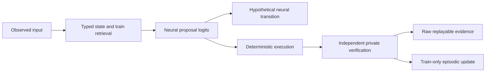

# V3 research foundation

V3 is additive under `mindscape.v3`. It intentionally leaves the historical decimal
records, learned policies, coding sandbox, V1/V2 evidence and two release tags
unchanged. The preservation verifier checks every one of the 574 original tracked
blobs against base `33c5b5657b2d19741b7b0ac84388d4f7997f9582`.

The central information boundary is the prediction/execution split. Backends receive
an `Observation` and a complete syntax candidate vocabulary, not a `Task`, evaluator,
expected output, split or private reference. A policy scores all candidates and
rejects singleton vocabularies. The backend separately predicts a hypothetical
transition. The adapter executes the selected action. Only then does the independent
evaluator compute a judgment. Evaluation judgments are saved, never fed back into
held-out action selection. Episodes currently allow exactly one action and no retry.

`schema.py` defines entities, relationships, concepts, goals, partial observations,
observed states, actions, neural predictions, actual transitions, rules with confidence
and evidence references, judgments, provenance and episodes. The JSON codec uses a
closed schema registry and explicit evidence kinds; it never loads pickle or arbitrary
Python types. Observation values must be finite. Action and task bounds are checked.
Dataclasses and tuples provide immutable ordinary records; this is an in-process
research boundary, not process isolation against malicious Python plugins.

`memory.py` stores verified actual training transitions, including valid incorrect
attempts. It supports domain/partition/identity-filtered retrieval, concept records,
evidence-linked rule hypotheses, and integrity-checked JSON persistence. Hypotheses
cannot enter actual memory. Held-out experience cannot support a stored rule. Current
smoke models log retrieved evidence but do not condition on it, so memory usefulness
is explicitly untested. Caller-supplied judgments are not cryptographic attestations;
trusted callers must use the kernel's independent evaluator.

`models.py` supplies a 1,287-parameter pure Python tanh MLP and the backend protocol.
Its policy and separate transition-regression head are both untrained in these
controls. Actual execution ignores predicted state contents. The historical adapter
is optional and unrun: explicitly approved local files, safetensors, local-only loading,
no remote code and GPT-Neo/GPT-NeoX architecture families (including Pythia). Scores
are conditional candidate sequence log likelihoods; sequence lengths are not normalized.
Pretraining contamination is unknown. The historical adapter's transition prediction
is a write-only hypothesis, not a learned world model.

`domains.py` supplies separate bounded adapters for integer addition, Python affine
offset repair and one-step discrete dynamics. The Python adapter executes a safe AST
subset through an interpreter with integer, node-count and source-length limits. It
permits no calls, imports, attributes, subscripting, loops, comprehensions or exponentiation.
This is not general CPython. The preserved WASI sandbox remains the appropriate
boundary for a future general repair adapter; there is no host-execution fallback.
Physical dynamics semantics are explicit semi-implicit Euler with unit time, not a
real-world simulator or a claim of physical understanding.

`experiment.py` freezes task manifests and validates canonical identity separation.
Each run binds source hash, manifest hash, checkpoint hashes, seeds and runtime.
An exclusive writer lock protects per-task atomic trace writes. Resume verifies hashes,
provenance, candidate selection, deterministic execution and private evaluation without
neural inference. Interrupted `.lock` or `.tmp` files fail closed and require operator
inspection; automated stale-lock recovery is deliberately absent. Hashes establish
integrity against a trusted manifest, not authenticity against an attacker rewriting
all receipts. The trace stores all seven stages, actual scores, chosen action, predicted
state, actual state, judgments, call count, parameter count, elapsed and CPU time.

The current tasks are one-step and fully observed; partial observations are typed but
not benchmarked. General multi-step planning, calibration, learned rule induction,
gradient training, optimizer-state resume, larger coding tasks and continuous dynamics
are future domain-training work. No trained baseline, memory effect, generalization
advantage or reasoning breakthrough is claimed. This foundation supplies a small
executable boundary test and reusable interfaces, not a finished cognitive learner.
