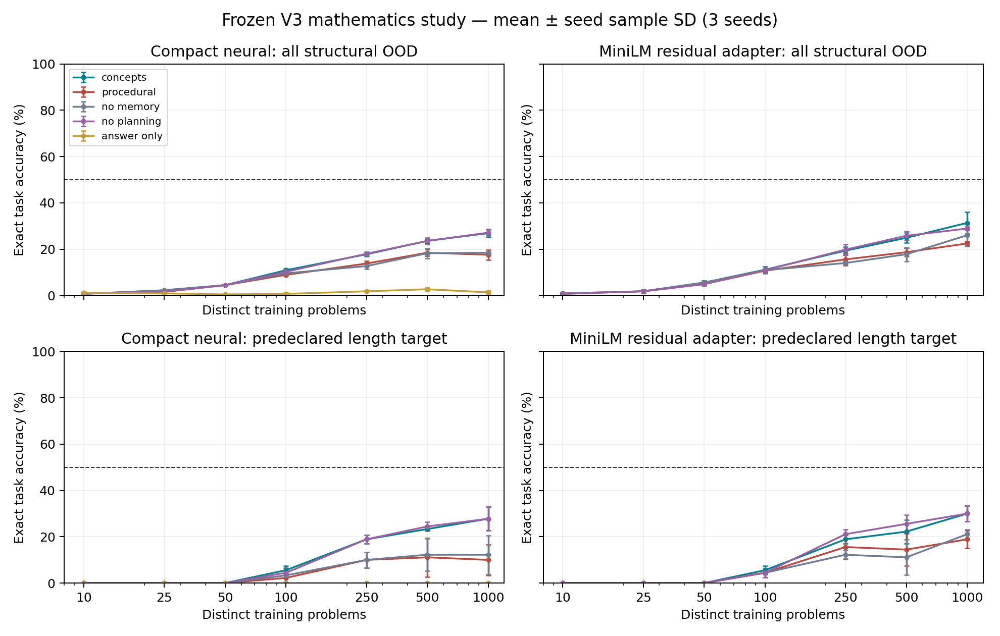

# Mindscape V3 mathematical learning study v1

**Result: the predeclared target was not achieved, and neural rule necessity is not
established.** Working models learn useful local mappings, but the strongest control
shows that much of the apparent concept benefit can come from finite demonstration
retrieval. No broad mathematical-reasoning or autonomous concept-discovery claim is
supported. The final lockbox remains encrypted and unopened.

## Frozen design and actual execution

Source/protocol/dataset freeze: `b43d778`. Manifest SHA-256:
`da5404cf71256e3ed34e4ed56e1fe0d9a10f1f5132dae2c4b21b5047971ff253`.
The complete protocol is [protocol.md](protocol.md). Original V1/V2 files and the
validated V3 kernel are preserved; this is an additive mathematical namespace.

Generated partitions: 1,000 training, 60 validation, 90 IID, 150 structural OOD,
and 90 encrypted lockbox tasks. OOD has 30 tasks per predeclared family: unseen
operand length, carry chains, digit compositions, right-operand sign changes and
two-operation composition. Canonical identities are disjoint across every split.
Abstract operations and local contexts intentionally overlap: this tests transfer
of familiar rules, not semantic independence of every example. Carry-chain shifts
also introduce longer inputs and 9s, so that family does not isolate one factor.

Learning curves use nested budgets 10/25/50/100/250/500/1,000 and seeds 0/1/2.
Every trained checkpoint is the fixed final update of 600 Adam steps, lr .003,
batch 64. No validation or OOD result chose a checkpoint, budget or hyperparameter.
There are 42 compact checkpoints (21 answer-only, 21 procedural) and 21 pretrained-
representation adapter checkpoints. All 63 actually trained; optimizer and RNG
state are retained. The 50% aspiration was specifically assigned to the **length**
family before evaluation. It is not reassigned to an easier successful family.

Compact primary evaluations: 33,000 repeated executions. Secondary adapter:
26,700. Four explicitly post hoc full-mechanism controls add 1,200 compact
executions. In total, 60,900 executions reuse the same **300 distinct development
tasks** across seeds, methods and budgets; these are not 60,900 independent tasks.
Raw traces, unique-context logits, failures, checkpoints, training ledgers and
independent replay receipts are retained. No lockbox result is included.

## What is learned and what is supplied

The compact neural network has 109,843 trainable parameters. It predicts local
operation, signed raw value, digit, carry/borrow, next digit/carry, final sign and
whether a proposed transition is consistent. The secondary model adds a rank-eight
residual representation adapter (4,096 parameters), for 113,939 trainable parameters,
over a frozen local MiniLM encoder with 22,713,216 parameters. This is representation
adaptation, not full transformer training or internal LoRA. All backbone files are
hash-bound; no new model was downloaded.

Each proposed next digit and carry is executed unchanged, including incorrect values.
The arithmetic verifier runs after the complete rollout. Neither planner nor memory
can query current correctness. The planner scores at most four alternatives using
neural log probability and learned consistency. All factorized numerical choices
remain syntactically available; there is no target-dependent singleton mask.

Important scaffold: place-value scheduling, signed-magnitude normalization/sorting,
and decimal materialization are hand-specified. The normalized primitive operation
is supplied as a local instruction, so operation-head accuracy is conditional
instruction following, **not evidence of learned operation scheduling**. The model
must still predict numerical claims and sign; the executor does not calculate them
for the learner. Learned next-state prediction here means numeric next-state contents;
control cursor advancement is deterministic. These results do not demonstrate
learning an entire arithmetic algorithm from examples without procedural knowledge.

Concept memory is a finite training-demonstration map keyed by operation, operand
digits and incoming carry. Relational predicates (equal, less than, zero, incoming
carry, nine) are also supplied to the equal-information baseline. Exact retrieval
adds a fixed logit bias; it does not synthesize an arithmetic answer. At 1,000
problems there are only **373 unique demonstrated local contexts**. This mechanism
is empirical instance reuse rather than induced symbolic rules or a learned
knowledge graph. Successful retrieval must not be described as neural generalization.

## Matched comparisons and learning curves

The procedural baseline and concept/memory/planning conditions share the **same
trained checkpoint**, teacher labels, observations, relational features and gradient
updates. Their contrast isolates the declared inference wrapper, with additional
memory/search compute reported. The no-memory and no-planning ablations keep weights
fixed. The answer-only network has the same architecture and receives the same
training dataset, but optimizes final-answer labels only. Its active supervision
differs, so it is not the primary architecture comparator. A pretrained answer-only
curve was not run; the secondary study uses procedural supervision and its ablations.

All entries below are mean exact OOD task accuracy across three seeds, in percent.

| Distinct problems | Compact answer-only | Compact procedural | Compact concepts | Compact length | Adapter procedural | Adapter concepts | Adapter length |
|---:|---:|---:|---:|---:|---:|---:|---:|
| 10 | 1.11 | 0.89 | 0.67 | 0.00 | 0.67 | 0.89 | 0.00 |
| 25 | 0.89 | 1.56 | 2.22 | 0.00 | 1.78 | 1.78 | 0.00 |
| 50 | 0.44 | 4.44 | 4.44 | 0.00 | 4.89 | 5.56 | 0.00 |
| 100 | 0.67 | 8.89 | 10.89 | 5.56 | 10.67 | 11.11 | 5.56 |
| 250 | 1.78 | 13.78 | 17.78 | 18.89 | 15.56 | 19.33 | 18.89 |
| 500 | 2.67 | 18.44 | 23.56 | 23.33 | 18.67 | 24.89 | 22.22 |
| 1,000 | 1.33 | 17.56 | 26.89 | 27.78 | 22.44 | 31.33 | 30.00 |

Machine-readable curves, every cell's Wilson interval and seed sample SD are in the
analysis artifacts and [CSV](figures/learning-curves.csv). Curves are not forced to
be monotonic: compact procedural accuracy decreases from 500 to 1,000 examples.
The first observed budget reaching 50% on the predeclared length family is
**not_reached** for both concept systems. A threshold-based data-efficiency advantage
therefore cannot be estimated at that target; no extrapolated crossing is claimed.

At 1,000 demonstrations:

| Condition | Compact overall OOD | Adapter overall OOD |
|---|---:|---:|
| Answer-only | 1.33 ± 0.67 | Not run |
| Equal-information procedural | 17.56 ± 2.14 | 22.44 ± 1.02 |
| Concepts + memory + planning | 26.89 ± 1.68 | 31.33 ± 4.67 |
| Without memory | 18.44 ± 0.38 | 26.00 ± 4.81 |
| Without planning | 27.11 ± 1.39 | 28.89 ± 0.77 |

These are mean ± sample SD across seeds, not independent confidence intervals.
Concepts minus procedural is +9.33 percentage points for compact, with task-cluster
bootstrap 95% interval +5.78 to +13.11 points. Exact per-seed paired tests pass the
predeclared 63-test Holm family (adjusted p .0149, .0165, .0076). Adapter difference
is +8.89 points, interval +6.00 to +12.00; only one seed passes its corresponding
Holm family. These statements are conditional on the sampled tasks and three fixed
seeds. They do not establish a neural concept mechanism, especially given the
full-memory zero-weight control below. No cross-backbone causal pretraining claim
is made from these two architectures.

## Controls that change the interpretation

With memory/planning removed, all three random-weight controls score 0/150 OOD in
each study. The zero-weight control scores 1/150: an actual zero-answer task, not a
fabricated zero or perfect controller rescue. The explicitly labeled deterministic
arithmetic oracle scores 150/150. It is an upper bound, not a learned baseline.

After observing the initial curves, a **post hoc** compact-backbone control retained
the 1,000-demonstration memory and planning while zeroing all weights. It scores
**49/150 OOD (32.67%)**, versus trained concepts' 26.89% mean. Its length score is
9/30 (30%), and its composition score is 20/30 (66.67%). Random weights with the
same memory/planning score 39/150, 17/150 and 48/150. No inferential test is claimed
for this added diagnostic, and it does not change the predeclared primary results.

This is not the historical exact-verifier mask confound: the lookup contains only
training demonstrations, multiple numerical candidates remain available, and the
current-task verifier is inaccessible until rollout completion. Nevertheless it
shows **trained neural weights are not necessary for this level of wrapper success**.
The result is compatible with empirical local lookup plus hand-specified composition,
not an established advantage from abstract neural rule induction. Reporting only
random/zero controls without memory would have hidden this important explanation.

## Failure analysis

| OOD family, 1,000 examples | Compact concepts | Adapter concepts |
|---|---:|---:|
| Unseen length (predeclared target) | 27.78% | 30.00% |
| Carry chains | 0.00% | 11.11% |
| Digit composition | 20.00% | 22.22% |
| Sign changes | 25.56% | 28.89% |
| Two-operation composition | 61.11% | 64.44% |

Composition exceeds 50%, but it is a secondary family and heavily uses familiar
local contexts under a hand-written schedule. It does not satisfy the declared target.

For compact concepts, over the three seeds' 450 repeated OOD rollouts, next-state
contents are correct on 4,516/4,680 demonstrated-context steps (**96.50%**) but only
40/629 unseen-context steps (**6.36%**). Adapter values are 4,491/4,648 (**96.62%**)
and 90/659 (**13.66%**). These are descriptive step counts conditional on self-generated
states, not independent-task accuracy estimates. They strongly indicate local-context
coverage failure rather than broad rule extrapolation.

Compact has 753 next-state errors across 5,309 steps. Of 1,000 steps with a nonzero
incoming carry/borrow, 516 have wrong next-state contents. Carry-chain tasks all fail
in the compact study. Once a wrong carry is written, later states follow the model's
own wrong state; execution does not restore the reference trajectory. Sixty of the
540 stage-sign decisions are wrong; all 60 occur in failed tasks. The sign-change
family remains weak, rather than being repaired by deterministic sign arithmetic.

On 646 of the 753 compact next-state errors (85.79%), the correct digit/carry pair
lies outside the planner's top-two-per-head search. The learned scorer cannot recover
a candidate that is never proposed. The consistency classifier also falsely accepts
618 inconsistent claims. Its single-field training corruptions do not establish
calibration for correlated, off-trajectory model errors. No-planning slightly exceeds
full concepts for compact (+0.22 points), with no reliable paired effect. This does
not support a useful compact planning mechanism.

Exact task success can hide inconsistent intermediate predictions: compact has
121/450 exact successes but only 114/450 strict all-head-consistent successful
rollouts. Adapter has 141/450 exact successes and 127/450 strict successes. Both
metrics and every raw intermediate failure are retained. Example-only smoke inputs
also retain success and failure: 1234+4321 yields 5555; 9999+1 incorrectly yields
9999 in the demonstrated compact checkpoint. These two post hoc examples are not
added to benchmark accuracy evidence.

## Information and compute accounting

At budget 1,000 each regime receives 1,000 distinct problems and teacher demonstrations,
5,297 intermediate rows (31,782 scalar numerical labels), 1,000 sign labels and
18,000 final-answer scalar labels. The procedural consistency learner also uses
5,297 positive-source/template rows and generates corrupted negatives during
training. The ledger's negative template count is not a count of unique sampled
corruptions. Each procedural checkpoint samples 38,400 local rows, 38,400 task rows,
38,400 sign rows and 76,800 consistency rows over 600 updates. Answer-only uses the
same 38,400 sampled task rows but no active intermediate losses. No online environment
feedback is requested. Teacher labels are counted separately from distinct examples.

Actual gradient updates: 25,200 compact, 12,600 adapter, total 37,800. Summed measured
optimizer-loop wall time is 40.736 seconds compact and 32.177 seconds adapter. Original
predeclared evaluation groups sum to 20.292/22.531 wall seconds and 20.235/22.687 CPU
seconds respectively; these exclude outer setup and include shared local prediction
cache effects. The post hoc control compute is separately recorded in its receipts.
These are not cold, dedicated latency measurements or energy/peak-memory measurements.
The two studies overlapped in wall execution on the local CPU, so contention can
also affect timings. Peak memory was not captured and is not retrospectively invented.

The frozen encoder actually processed 64,026 tokens in 980 forward batches, with
2,003 cached observational representations. Its initial invocation receipt is
retained separately from resume's zero-forward/zero-token receipt. Per-model token
fields are cumulative shared encoder-cache work, not additive per-model training
cost. Compact features have no text tokens. No paid service or model download was used.

## Validation and revised hypothesis

Local suite: **188 tests plus six subtests, zero skips/failures**, including 20 math
security/leakage/gradient/resume tests. Scoped Ruff passes. All 60,900 saved executions
independently replay with zero neural forwards. All 63 checkpoints are hash-bound;
completed training and evaluation resume without changing weights or redoing neural
rollouts. Pretrained adapter-gradient tests verify both residual matrices update.
The frozen lockbox is never read by the experiment runner; its key is outside the
committed dataset namespace. Existing V1/V2 preservation receipts still verify all
574 original tracked files and both release tags. The V3 foundation is unchanged.

**Revised hypothesis, not a tuned result:** these categorical networks learn a
fragmentary finite transition table. Exact retrieval dominates where demonstrations
cover a context; ordinal and carry structure do not extrapolate reliably. A next
version should compare a numeric/relational inductive bias against an equally
informed flat model using balanced elementary-context coverage at the same declared
teacher-query budget. It should separately test whether graded numeric embeddings
improve unseen local contexts, whether abstention/calibration works on self-generated
errors, and whether planning helps when true candidates enter the search. Retain
memory-only/zero-weight controls as mandatory competitors. Freeze new development
holdouts before that study, and keep this lockbox sealed. This hypothesis has not
been executed or validated here.

**GO:** reproducible bounded mathematical learning research system and negative-result
analysis. **NO-GO:** claim of abstract neural numerical-rule learning, autonomous
arithmetic procedure discovery, the predeclared 50% target, or alternate-base claims.
No lockbox tuning, test-difficulty adjustment, V1/V2 rewrite or hidden successful-run
selection occurred.
