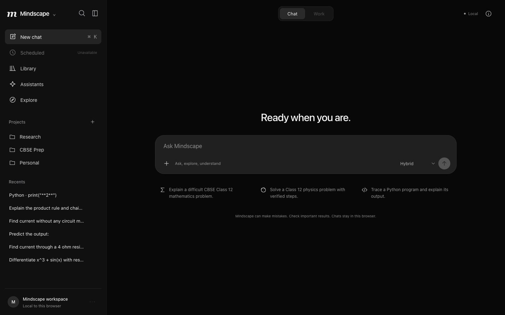
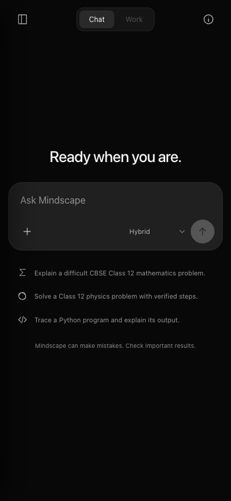

# Real visual review

The requested two images were unavailable. This is a comparison against the written visual specification and a historical actual Mindscape screenshot, not a claim of pixel matching to unseen images. `before-historical-interface.png` is copied unchanged from earlier real application proof. All five historical web source files match the pre-redesign baseline by SHA256; that old screenshot is not a fresh same-viewport capture or a user-supplied reference.

| Viewport | Navigation | Composer | Page horizontal overflow |
|---|---|---|---|
| 1440×900 | 320px sidebar | 860×111px | None |
| 1920×1080 | 354px sidebar | 860×111px | None |
| 1280×832 | 320px sidebar | 860×111px | None |
| 768×1024 | 300px drawer (closed) | 732×115px | None |
| 390×844 | 300px drawer (closed) | 362×115px | None |
| 320×640 | 272px drawer (closed) | 292×115px | None |

At1440px the sidebar is320px and composer860px; at1920px the sidebar is354px. At768px and below the sidebar becomes a300px (max85vw) drawer. At390px the composer is362px; at320px it is292px. Every saved final screenshot has its requested pixel dimensions, with matching body/viewport height and no page horizontal overflow. An additional390×420 reduced-height check kept the composer bottom below the viewport; this is a keyboard-space simulation, not physical-device certification.

Visual changes: near-black #080808 workspace, #101010 sidebar, #202020 composer, system sans-serif, restrained30px desktop welcome, thin SVG icons, subtle hover/focus states and centered Chat/Work segmentation. No gradients, particles, illustrations, decorative bright cards or browser chrome. Small captions were brightened for readability. Focus rings, reduced-motion CSS and native dialog/drawer keyboard handling are present; a formal accessibility audit was not performed.

The desktop and phone screenshots below are generated from the actual app. Recents show real test conversations, not hardcoded history. Other local captures cover actual mathematics, Python, SQL, literal stdout, the drawer and the429 preservation state.

## Desktop1440×900

## Mobile390×844

Full local gallery: viewport-1920.jpg, viewport-1440.jpg, viewport-1280.jpg, viewport-768.jpg, viewport-390.jpg, viewport-320.jpg. Screenshot files are JPEG. When reference images arrive, compare their geometry/colors/type directly before claiming reference fidelity.
